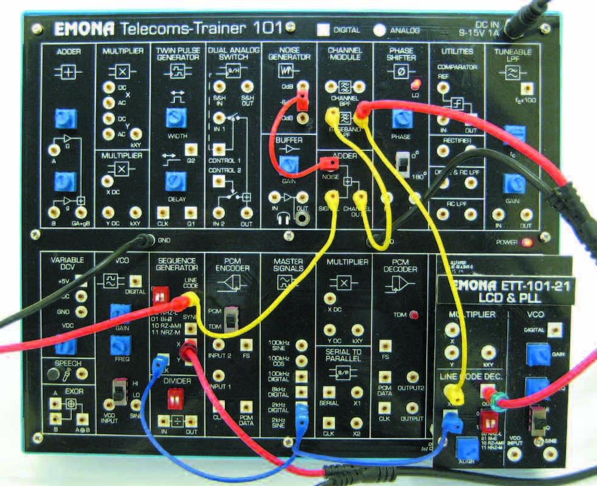
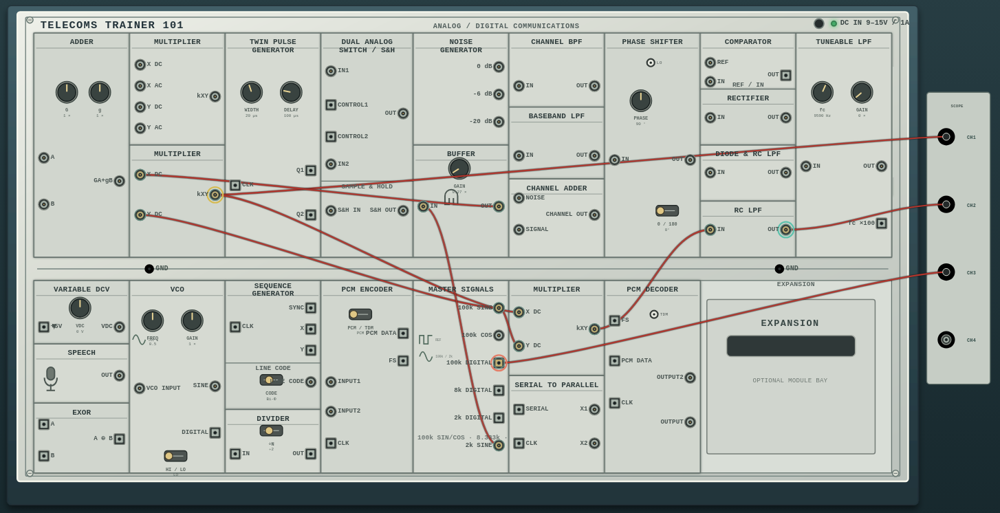

# Virtual Telecoms Lab

[🔗 Live Demo - Virtual Telecoms Lab](https://virtual-telecoms-lab-3bmgeed.vercel.app/)

Virtual Telecoms Lab is a local-first, browser-based ETT-101 digital twin. It centers on an individually rendered, fixed two-row telecoms trainer panel; users patch its real modeled sockets, change the physical controls, solve the connected DSP graph and probe the resulting signals.

| Emona Hardware Reference | Virtual Telecoms Lab Project |
| :---: | :---: |
|  |  |

The supplied product photograph is the visual reference. The hardware inventory and per-socket roles are cross-checked against the manufacturer’s user manual and specification sheet where available. See [the hardware reconstruction and source notes](docs/hardware-reconstruction.md) before treating undocumented behavior, colors or revision-dependent ranges as exact physical measurements. The outer `280 × 240` SVG coordinates follow the photo’s overall aspect ratio; all panel positions are normalized design units, not claimed physical millimeters.

## Run locally

Requirements: Node.js 20+ and pnpm 11.

```sh
pnpm install
pnpm dev
```

The Vite development server listens on `0.0.0.0:3000`. Run the checks with:

```sh
pnpm exec tsc --noEmit
pnpm test
pnpm build
```

Core operation requires no account, Python service, hosted database or API key. Saved projects stay in the browser’s IndexedDB unless explicitly exported as JSON.

## Hardware panel and patching

On first launch, the standard two-row faceplate is already present as source-positioned React/SVG components; it is not a flattened picture or a movable block canvas. New starts an empty experiment on that same fixed board. Physically separate module instances—including the stacked multipliers and the three separate Multiplier cores—retain distinct stable IDs.

Analog round sockets and digital square sockets expose direction, printed label, type and stable identity. Start a virtual patch lead at an output and finish at a compatible input. An output can fan out to multiple independent leads, while each destination input is single-driver; incompatible types, duplicate edges and directed feedback cycles are rejected. Patch leads can be selected, rerouted, deleted, recolored, undone and inspected in the lead list. Clicking a lead selects it and reveals a contextual colour palette; hollow handles add bends and solid handles reshape the run without changing either endpoint. Routing points and colour are stored on the lead itself, survive deselecting, undo/redo and project export, and never trigger a DSP recalculation. Mouse/pointer and keyboard access are supported; narrow screens keep the original board proportions and scroll horizontally.

Numeric knobs, selectors and the physical controls change actual project parameters. The Phase Shifter, variable DC source, oscillator range, divider, filter and PCM mode are model controls, not decorative UI. The master references start with CH1 and CH2 probed; CH3/CH4 can be assigned independently to any registry-defined hardware output.

## DSP and measurements

The simulation engine is typed, numerical and separate from the React view. It routes `Float64Array` signal buffers by stable socket endpoints, schedules dependencies in graph order, supports output fan-out, calculates only connected/probed functions, diagnoses missing active inputs, and runs in a Web Worker. Seeded noise makes experiments reproducible. Microphone capture is optional and requires an explicit browser permission; captured audio stays in memory and is never serialized to a project.

The registry includes the fixed hardware sources and modeled functions: Master Signals, Variable DCV, Speech, Noise Generator, VCO, Twin Pulse Generator, Adder, all three Multiplier cores, Buffer/headphone monitor marking, dual analog switching/S&H, Channel Module BPF/baseband filter/Adder, Phase Shifter, Tunable LPF, comparator, rectifier, diode-RC and RC filters, EXOR, sequence/line-code, divider, PCM encoder/decoder, and Serial-to-Parallel. Each registered processor calculates its output samples; there are no hard-coded instrument traces.

The separate four-channel scope has independent probe, enable, volts/division and vertical-position state, time/division, trigger controls, Auto Setup, continuous Run/Stop and one-shot Single acquisition that holds its frame. Worker windows advance in absolute sample time; the STOP/HOLD state retains the last completed trace. The spectrum analyzer performs an FFT of an actual selected physical output in a worker and marks detected peaks.

The built-in reference rates use the manufacturer’s precise values where the silkscreen is rounded: 100 kHz quadrature carrier, 2.083 kHz sine/digital reference and 8.333 kHz digital reference. A connected 2.083 kHz message and 100 kHz carrier therefore generate DSB-SC sidebands by real pointwise multiplication, without an added carrier term.

## Projects and validation

Save/Open uses IndexedDB; Import/Export uses versioned JSON. A project preserves all fixed physical functions, parameters, patch endpoints, colours, manual routing bends, scope probes/settings, experiment state and display/simulation preferences. Imports validate panel identity, socket IDs, parameter bounds, routing points and graph constraints and do not execute project data as code. The microphone capture buffer is intentionally excluded.

The test suite checks the source-derived panel bounds and port anchors; strict imported-project validation; Adder and Multiplier arithmetic; Buffer gain; VCO frequency and phase behavior; low-pass attenuation; deterministic noise taps; PCM encoding/decoding; actual DSB-SC sidebands and carrier suppression; cycle/input/type errors; scope probes; cable routing geometry and clamping; routing/colour round-trips without DSP signature changes; and the mandatory case where one oscillator output feeds two Multiplier inputs and two independent scope channels. It also checks that removing one cable does not disturb the other branches.

## Known limitations

This is an active digital-twin implementation, not a claim that every hardware-specific detail has been calibrated or that the complete master brief is finished. The small supplied image and public monochrome drawing do not establish per-socket wire colors or physical front-panel millimeter measurements. The `LO` and `TDM` ringed markings remain nonpatchable indicators pending revision-specific confirmation. The manufacturer’s LPF manual and specification sheet disagree on the cutoff/gain ranges; the software marks the modeled range approximate. Several responses (notably the Phase Shifter’s Hilbert approximation, filter transfer functions, switch truth table, noise bandwidth and exact digital-state details) are documented teaching models rather than measured unit-level emulations. Filters and other stateful blocks are reinitialized per calculated window, so continuity across adjacent live frames is not yet hardware-stateful.

The reusable guided library of 18 editable communications experiments, complete step-by-step Learning Mode, advanced cursors/coupling/FFT controls, project rename/duplicate/Save As and full revision-specific physical calibration are not yet implemented. Do not infer exact hardware limits from an approximate software parameter or treat a labeled roadmap item as an available experiment.

## Architecture

- `src/hardware/layout.ts` — normalized fixed panel regions, physical module instances and stable socket anchors.
- `src/hardware/HardwareBoard.tsx` and `controls.tsx` — SVG enclosure/panel, sockets, controls, connection layer and editable faceplate interactions.
- `src/modules/registry.ts` — documented physical port/parameter schemas and processor dispatch.
- `src/engine` — numerical processors, socket-graph validation/scheduling, measurements, FFT and simulation/FFT workers.
- `src/instruments/InstrumentDock.tsx` — independent four-channel scope and spectrum analyzer.
- `src/project` and `src/storage` — version-2 physical-panel project validation and local IndexedDB repository.
- `docs/hardware-reconstruction.md` — user-photo comparison, official references, reconstructed module/socket inventory and unresolved source questions.
- `tests` — regression coverage for geometry, DSP, patch-graph behavior and safe project files.

## Sources

- EMONA, [Telecoms-Trainer 101 User Manual](https://www.emona-tims.com/wp-content/uploads/2015/07/ETT101-SAMPLE-UserManual.pdf).
- EMONA, [ETT-101 BiSKIT Specifications v1.1](https://www.emona-tims.com/wp-content/uploads/2015/07/ETT101-specifications-V1_1.pdf).
- EMONA, [Compact Experimenter product page](https://www.emona-tims.com/emona-product/compact-experimenter/).

## Theming

All design values live in `src/styles/tokens.css`: one `--radius` for every rounded corner, the 13-step gray scale (`--gray-0` black … `--gray-12` white), semantic roles (page, surface, panel face, jacks, knobs), scope/spectrum colours (`--scope-*`, `--ch1…--ch4`) and patch-cable colours (`--cable-*`). `src/styles/design.css` is the flat faceplate pass that reads those tokens. The oscilloscope and spectrum canvases read the same variables, so changing a token restyles them too.
